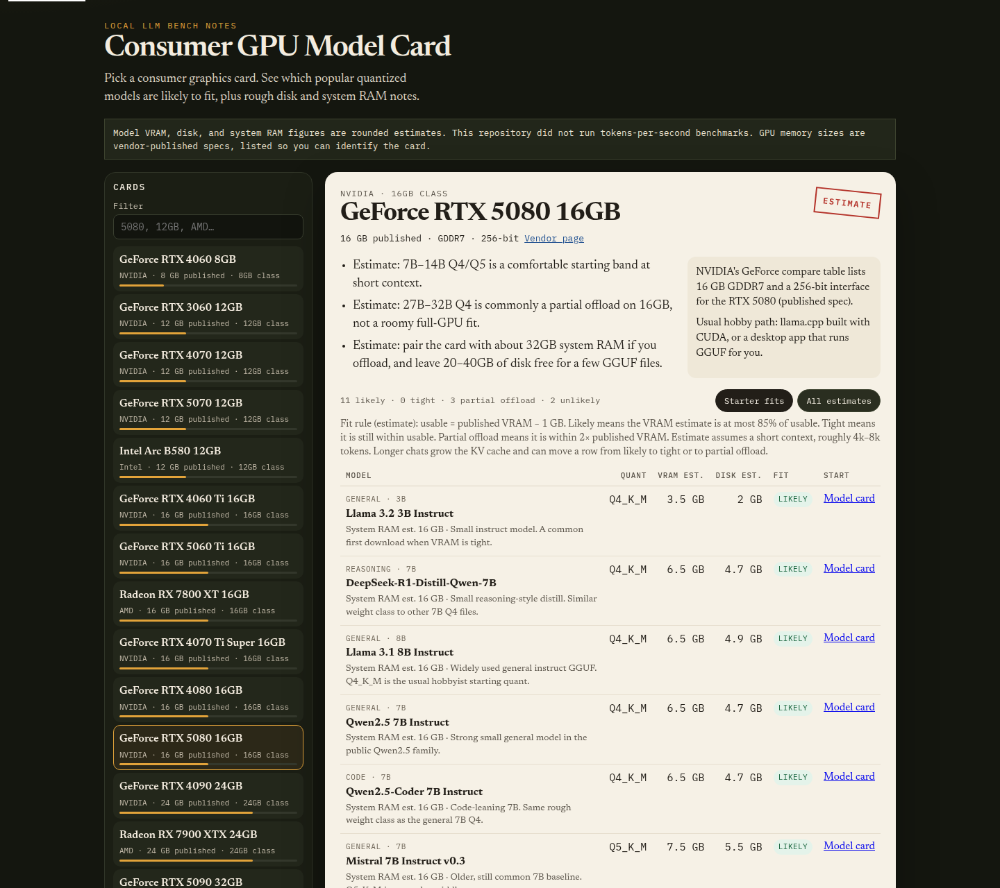

**Language:** [English](#english) · [简体中文](#zh-hans) · [繁體中文](#zh-hant) · [日本語](#ja)

<a id="english"></a>

# Consumer GPU Model Card

Pick a consumer graphics card, such as an RTX 5080 16GB, and get a one-page card: which popular quantized / GGUF-style LLMs are likely to fit, with rough VRAM, disk, and system RAM notes, plus start-here links.

The audience is hobbyists and first-time local-LLM builders. Every model figure is an **estimate**. GPU memory sizes are vendor-published specs, listed so you can identify the card. This repository did not run tokens-per-second benchmarks.



Local Chrome capture of the static page after choosing RTX 5080 16GB. The numbers on screen are the catalog estimates, not a measured run.

## Try it in 3 steps

1. In this folder run `python3 -m http.server` and open `http://127.0.0.1:8000/` (or open the GitHub Pages URL if you have published the root).
2. Pick a GPU, or enter another VRAM size.
3. Read the card. Starter fits are the rows the estimate rule calls likely or tight.

Opening `index.html` as a `file://` URL can block the catalog fetch. Use the local server or Pages.

## Command line

```bash
python3 cli.py --list
python3 cli.py rtx-5080-16gb
python3 cli.py --vram 12 --name "Used 12GB card"
python3 scripts/check.py
```

The CLI uses the Python standard library. `scripts/check.py` checks that the catalog has at least 8 GPUs (including 12GB and 16GB classes) and at least 12 estimated models, then exits 0.

## What the fit words mean

The page and the CLI share one rule, stored in `data/catalog.json`:

- Usable VRAM, estimate: published VRAM minus 1 GB.
- **Likely:** the model's VRAM estimate is within 85% of usable.
- **Tight:** it still lands within usable.
- **Partial offload:** it is within 2× published VRAM, so some layers may sit in system RAM. That path is usually slower. This is not a speed measurement.
- **Unlikely:** the estimate is above that.

The context assumption is roughly 4k–8k tokens. Longer chats need more KV cache. The model list is a curated sample of well-known public names, not a leaderboard, and it will go stale.

## Files

- `index.html` — static page for GitHub Pages
- `data/catalog.json` — GPUs, models, and the estimate rule
- `cli.py` / `cardlib.py` — text card
- `scripts/check.py` — shape check
- `docs/demo-rtx-5080-card.png` — local browser capture

Possible later extra: an optional script pack or a parts affiliate link. The card stays free.

<a id="zh-hans"></a>

# 消费级 GPU 模型卡

选择一张消费级显卡（例如 RTX 5080 16GB），得到一张静态模型卡：哪些常见的量化 / GGUF 风格大模型大概放得下，以及粗略的显存、磁盘和内存提示，附上起步链接。

对象是海外想在本地跑模型的爱好者，以及第一次装卡的人。模型相关的数字都是**估算**。显卡容量用的是厂商公开规格，用来认卡，不是本仓库测出来的可用显存。本仓库没有跑过每秒 token 的测速。

## 三步试用

1. 在本目录运行 `python3 -m http.server`，打开 `http://127.0.0.1:8000/`（如果已经用 GitHub Pages 发布根目录，也可以直接打开那个网址）。
2. 选择一张显卡，或自行输入显存容量。
3. 阅读模型卡。「起步」视图里是估算规则判定为 likely 或 tight 的行。

用 `file://` 直接打开 `index.html` 时，浏览器可能拦截目录数据。请用上面的本地服务器或 Pages。

## 命令行

```bash
python3 cli.py --list
python3 cli.py rtx-5080-16gb
python3 cli.py --vram 12 --name "Used 12GB card"
python3 scripts/check.py
```

命令行只用 Python 标准库。`scripts/check.py` 会检查目录里至少有 8 张显卡（含 12GB 与 16GB 档）和 12 条估算模型，通过时退出码为 0。

适配规则写在 `data/catalog.json`：从公开显存里留出 1 GB，估算显存不超过可用部分的 85% 记为 likely，仍在可用部分内记为 tight，不超过公开显存 2 倍记为 partial offload，其余记为 unlikely。上下文按大约 4k–8k token 估算。更长对话会增加 KV cache。模型列表是公开名称的示例，不是排行榜，也会过时。

页面截图在 `docs/demo-rtx-5080-card.png`，是本地浏览器打开静态页后的实拍，画面上的数字是目录里的估算，不是实测。

以后如果有额外内容，也只会是可选的脚本包或配件联盟链接。这张模型卡保持免费。

<a id="zh-hant"></a>

# 消費級 GPU 模型卡

選一張消費級顯示卡（例如 RTX 5080 16GB），得到一張靜態模型卡：哪些常見的量化 / GGUF 風格模型大概放得下，以及粗略的 VRAM、磁碟與系統記憶體提示，並附上起步連結。

對象是想在本機跑模型的愛好者，以及第一次裝卡的人。模型相關數字都是**估計**。顯示卡容量用的是廠商公開規格，用來辨認型號，不是這個儲存庫量到的可用 VRAM。這裡沒有跑過每秒 token 的測速。

## 三步試用

1. 在此資料夾執行 `python3 -m http.server`，開啟 `http://127.0.0.1:8000/`（若已用 GitHub Pages 發布根目錄，也可以直接開那個網址）。
2. 選一張顯示卡，或自行輸入 VRAM 容量。
3. 閱讀模型卡。「起步」檢視顯示估計規則判為 likely 或 tight 的列。

用 `file://` 直接開啟 `index.html` 時，瀏覽器可能擋住資料載入。請改用上面的本地伺服器或 Pages。

## 命令列

```bash
python3 cli.py --list
python3 cli.py rtx-5080-16gb
python3 cli.py --vram 12 --name "Used 12GB card"
python3 scripts/check.py
```

命令列只用 Python 標準函式庫。`scripts/check.py` 會確認資料至少有 8 張顯示卡（含 12GB 與 16GB 級）以及 12 筆估計模型，通過時結束碼為 0。

規則寫在 `data/catalog.json`：公開 VRAM 先留 1 GB，估計 VRAM 不超過可用量的 85% 為 likely，仍在可用量內為 tight，不超過公開 VRAM 的 2 倍為 partial offload，其餘為 unlikely。上下文大約按 4k–8k token 估計。更長的對話會增加 KV cache。模型清單是公開名稱的範例，不是排行榜，也會過時。

截圖在 `docs/demo-rtx-5080-card.png`，是本地瀏覽器開啟靜態頁後的實拍。畫面上的數字是目錄中的估計，不是實測。

之後若有額外內容，也只會是可選的腳本包或零件聯盟連結。這張模型卡維持免費。

<a id="ja"></a>

# コンシューマ GPU モデルカード

RTX 5080 16GB のようなコンシューマ GPU を選ぶと、よく使われる量子化 / GGUF 系 LLM が入りそうかどうかのカードが出ます。VRAM・ディスク・システム RAM の目安と、最初に開くリンク付きです。

想定読者は、海外でローカル LLM を試す趣味の人、および初めて GPU を組む人です。モデル側の数字はすべて**見積もり**です。GPU の容量は製品を見分けるためのベンダー公開スペックであり、このリポジトリで測った空き容量ではありません。tokens/秒のベンチマークは行っていません。

## 3 ステップ

1. このフォルダで `python3 -m http.server` を実行し、`http://127.0.0.1:8000/` を開く（ルートを GitHub Pages に出している場合はその URL でもよい）。
2. GPU を選ぶか、VRAM 容量を入力する。
3. カードを読む。最初の表示は、見積もりルールが likely または tight とした行です。

`index.html` を `file://` で直接開くと、カタログの読み込みがブロックされることがあります。ローカルサーバか Pages を使ってください。

## コマンド

```bash
python3 cli.py --list
python3 cli.py rtx-5080-16gb
python3 cli.py --vram 12 --name "Used 12GB card"
python3 scripts/check.py
```

CLI は Python 標準ライブラリだけです。`scripts/check.py` は GPU が 8 件以上（12GB 級と 16GB 級を含む）かつ見積もりモデルが 12 件以上あることを確認し、成功時は終了コード 0 です。

ルールは `data/catalog.json` にあります。公開 VRAM から 1 GB を控えた残りを目安の空きとし、見積もり VRAM がその 85% 以内なら likely、空き以内なら tight、公開 VRAM の 2 倍以内なら partial offload、それ以上は unlikely です。コンテキストはおおよそ 4k–8k トークンの見積もりです。長い会話では KV キャッシュが増えます。モデル一覧は有名な公開名の見本であり、ランキングではなく、古くなります。

画面写真は `docs/demo-rtx-5080-card.png` です。静的ページをローカルのブラウザで開いた実写で、表示中の数字はカタログの見積もりであり、計測値ではありません。

今後おまけでスクリプト集や部品のアフィリエイトリンクを足すことはあるかもしれません。このカード自体は無料のままです。
